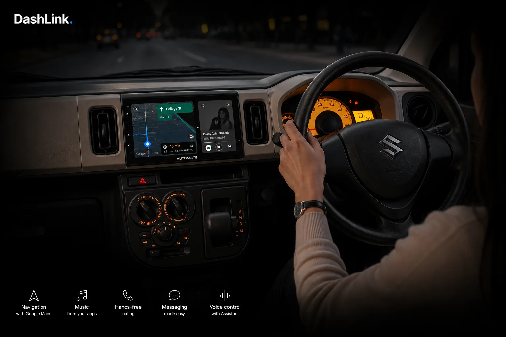

<div align="center">



# DashLink

**Turn the Android panel in your car into an Android Auto receiver.**

[](https://dashlink-automotive.github.io/)
[](https://github.com/dashlink-automotive/DashLink-Head-Unit/releases/latest)
[](https://github.com/dashlink-automotive/DashLink-Head-Unit/releases)


[**Visit the website**](https://dashlink-automotive.github.io/) ·
[**What's new**](https://dashlink-automotive.github.io/features/) ·
[**Download the APK**](https://dashlink-automotive.github.io/download/) ·
[**Get Premium**](https://dashlink-automotive.github.io/premium/) ·
[**Privacy policy**](https://dashlink-automotive.github.io/privacy/)

</div>

---

## About

DashLink brings wired and wireless Android Auto to aftermarket Android head units: Google Maps navigation, music, hands-free calls, messaging and Google Assistant on your dashboard screen.

This repository is the **source of the DashLink website**. It's plain static HTML with no build step, no framework and no server, hosted for free on GitHub Pages.

> [!NOTE]
> Looking for the app itself? Get the latest APK from the [download page](https://dashlink-automotive.github.io/download/), which includes a step-by-step install guide. Every new user starts with a **7-day free trial**.

## Features

| | |
|---|---|
| 🧭 **Navigation** | Google Maps, turn-by-turn, on the big screen |
| 🎵 **Music** | Spotify, YouTube Music and your other audio apps |
| 📞 **Hands-free calling** | Make and take calls from the dial pad |
| 💬 **Messaging** | Messages read aloud, replies by voice |
| 🎙️ **Voice control** | Google Assistant and Gemini |
| 🔌 **Wired or wireless** | USB, wireless, or a self-contained mode with no phone |

## Pages

| Page | Path | Purpose |
|---|---|---|
| Home | [`index.html`](index.html) | Product overview, features, FAQ |
| Features | [`features/index.html`](features/index.html) | The redesigned app: Home screen, Dock mode, Car care, Fuel &amp; costs |
| Download | [`download/index.html`](download/index.html) | APK download, USB install guide, troubleshooting |
| Premium | [`premium/index.html`](premium/index.html) | Unlocking Premium after the free trial |
| Privacy | [`privacy/index.html`](privacy/index.html) | Privacy policy |

```
.
├── index.html
├── features/index.html
├── download/index.html
├── premium/index.html
├── privacy/index.html
├── assets/images/      screenshots, photos, demo video (v2/ = redesigned app)
└── .nojekyll           serve files as-is (no Jekyll processing)
```

Every page is self-contained, with its CSS and JS inline. That means one request per page and nothing to build.

## APK distribution

The `.apk` is **not** stored in this repository. It's published as an asset on **[GitHub Releases](https://github.com/dashlink-automotive/DashLink-Head-Unit/releases)** in the app repository, which provides free CDN bandwidth and a version history.

When the download page loads, it asks the GitHub API for the latest release and then:

- points the **Download DashLink** button straight at the newest `.apk`
- shows that release's **version**, **file size** and **release date**

**Publishing a new release updates the site automatically, with no HTML edits.** If the API can't be reached (it allows 60 lookups per hour per visitor IP), the button falls back to the release page and the version details stay hidden.

> [!IMPORTANT]
> Publish the **Play-signed universal APK** from *Play Console → App Bundle Explorer → Downloads*. An APK signed with your local upload key has a different signature from the Play Store build, and users can't install one over the other.

## Development

There's nothing to install. Open any `.html` file in a browser, or serve the folder locally:

```bash
python3 -m http.server 8000
```

Then open <http://localhost:8000>.

### Common edits

| What | Where |
|---|---|
| APK link, version and size | Automatic. See `apk-download` in `download/index.html` |
| Google Play links | `download/`, `premium/`: search `play.google.com` |
| WhatsApp number | All pages: search `wa.me/` |
| Support email | All pages: search `dashlink.support` |
| Trial length | All pages: search `7 day` |
| Region rules | Page JS: search `BLOCKED` |

### Region handling

Two things depend on the visitor's country, which is inferred in the browser from the timezone, falling back to the locale:

- **Google Play badges** are hidden where the app isn't listed (IL, PK, DE).
- **The Premium purchase route** switches between Google Play Billing and manual device-ID activation. Play Billing only works in an app installed from Play, so Pakistan gets the manual route.

## Deployment

Pushing to `main` deploys the site. GitHub Pages rebuilds in under a minute.

**Pages settings:** *Settings → Pages → Deploy from a branch → `main` / `(root)`*

<details>
<summary><b>Adding a custom domain</b></summary>

<br />

There's deliberately no `CNAME` file yet. Adding one before the DNS records exist makes Pages redirect to a dead address.

1. Add a `CNAME` file at the repo root containing only the domain.
2. Go to *Settings → Pages → Custom domain*, enter the same domain and save.
3. At your registrar, point the apex `A` records to GitHub Pages:
   `185.199.108.153` · `185.199.109.153` · `185.199.110.153` · `185.199.111.153`,
   and add a `CNAME` record for `www` pointing to `dashlink-automotive.github.io`.
4. Tick **Enforce HTTPS** once the certificate is issued.
5. Search the HTML for `TODO`: `download/index.html` has a line telling users which address to type into their panel's browser.

</details>

## Support

- **Email:** [dashlink.support@gmail.com](mailto:dashlink.support@gmail.com)
- **WhatsApp:** [Chat with us](https://wa.me/923229914024)
- **Companion app:** [DashLink Wireless on Google Play](https://play.google.com/store/apps/details?id=com.auto.dashlinkwireless)

---

<div align="center">
<sub>© DashLink. All rights reserved. Android, Android Auto and Google Play are trademarks of Google LLC.</sub>
</div>
